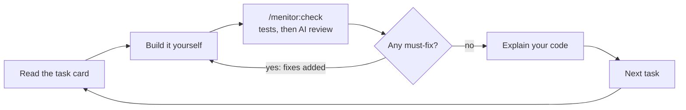

# Menitor

> **Requires Node.js 22 or newer on your PATH.** The task window and the state CLI run on Node.

Menitor is an open-source Claude Code plugin: a senior dev who runs your project like a sprint and makes you do the work. It turns a project idea into lean docs and an ordered task plan. Then it shows one task at a time in a browser window and checks your work before moving on.

It is free (MIT), runs fully locally on your existing Claude plan, and has no accounts or telemetry.

**Status:** in development. v1 is being built in milestones; see [docs/prd.md](docs/prd.md) for the product requirements and [docs/implementation-decisions.md](docs/implementation-decisions.md) for the choices made before the build.

| Milestone | State |
| --- | --- |
| 1. State CLI and schemas | Done |
| 2. Guard hooks | Done |
| 3. Skills and doc templates | Done |
| 4. Check runner | Done |
| 5. Task window | Done |
| 6. Window buttons through plugin monitors | Next |
| 7. README, ADRs and doc templates | Planned |

## Install

Menitor isn't ready for learners yet. To try the work in progress, in Claude Code 2.1.275 or later:

```text
/plugin install menitor --marketplace Issmuth/menitor
```

On older versions, add the marketplace first, then install:

```text
/plugin marketplace add Issmuth/menitor
```

```text
/plugin install menitor@menitor
```

## How it works

Every task runs the same loop: read the card, build it yourself, check it, then fix or move on.



## Commands

| Command | What it does | Who runs it |
| --- | --- | --- |
| `/menitor:start` | Interview, calibrate your level, set focus areas, write lean docs and the plan | You, typed |
| `/menitor:go` | Show the current task; picks up where you left off in a fresh session | You, or the agent when you ask to continue |
| `/menitor:check` | Run the checks, review your work, ask you to explain it, then pass or add fixes | You, or the agent when you say you're done |
| `/menitor:hint` | Reveal the next hint: concept, approach, pseudocode, then a partial snippet | You, or the agent when you ask for a hint |
| `/menitor:stuck` | Debug with you: what you tried, the error, the smallest useful hint | You, or the agent when you're stuck |
| `/menitor:skip [--explain]` | Hand the task to the agent, after one pushback; confirm with `--confirm` | You, typed only |
| `/menitor:off` and `/menitor:on` | Turn mentor mode off or back on | You, typed only |

Plain questions typed into the session still work. Commands are only for actions that change progress.

## The task window

`/menitor:go` opens a page in your browser that shows one task card at a time, beside or over your editor.

- **Live:** the card updates as soon as Menitor's state changes. There's no need to reload.
- **Ticks:** tick checklist items as you go. They're saved to `.menitor/progress.json`.
- **Buttons:** Check my work, Hint and I'm stuck. Until window buttons can wake the session (milestone 6), they copy the command for you to paste.
- **Pop out:** an always-on-top mini window through Document Picture-in-Picture in desktop Chromium browsers. Other browsers get a small separate window.
- **Progress:** milestone bars, and how many tasks you wrote versus how many were delegated.
- **Layout:** works from 320 px wide, in light and dark mode, and by keyboard.

The window server listens on 127.0.0.1 only and needs a random token on every request. The link's token is swapped for an HttpOnly, SameSite=Strict cookie on first load. Requests with the wrong `Host` or `Origin` are refused, which blocks other sites and DNS rebinding. The page has a strict Content Security Policy, and buttons send fixed events only, never free text. The server stops after 6 hours without a visitor.

```bash
node core/bin/menitor.js window open --no-browser
```

## The guard

While mentor mode is on, hooks keep the agent's hands off the learner's code:

- **File writes** outside `docs/` and `.menitor/` are denied on the learner's tasks. A deny holds even in bypass-permissions mode.
- **Shell commands** that would write project files are denied on a best-effort match. That covers redirects, `tee`, `sed -i`, copies, moves, deletes, downloads, inline scripts, git commands that change the repo, and installs or scaffolders.
- **Read-only work always runs:** builds, tests, linters, `git status`, `git diff` and `git log`.
- **State files** in `.menitor/` change only through the state CLI, even with mentor mode off.
- **Learner-only commands:** only the learner can hand a task over or turn mentor mode off, by typing `/menitor:skip --confirm` or `/menitor:off`. The guard reads the learner's typed prompt, so the agent can't fake either one.
- **Activity log:** every agent command and file write goes to `.menitor/activity.jsonl`, so the check can flag anything that slipped past.

Delegated tasks, and tasks the learner skipped, open project writes for that one task.

## Layout

```text
core/                     agent-neutral: works with any coding agent
  bin/menitor.js          the state CLI (the agent changes state only through it)
  lib/                    plan, learner, log, stats, card, docs, shell analysis and guard
  schemas/                JSON Schemas for every file in .menitor/
  server/                 the task window: a small HTTP server and a dependency-free page
  instructions/           what each command does, in neutral words
  templates/docs/         lean doc templates: PRD, tech, flow, design, data and API, testing, ADR
adapters/claude-code/     the thin Claude Code layer: hooks, command names and skills
  skills/                 generated from core/instructions by build-skills.js
.claude-plugin/           plugin and marketplace manifests
test/                     node:test suites
docs/                     PRD and implementation decisions
```

A learner's project keeps its state in `.menitor/`, split by writer so nothing overwrites anything else:

| File | Written by | Holds | In git |
| --- | --- | --- | --- |
| `plan.json` | the CLI | milestones, tasks, checklists, done-when criteria, owners, hints | yes |
| `session.json` | the CLI | current task, start commits | no |
| `progress.json` | the window | checklist ticks | no |
| `guard.json` | hooks, from commands the learner typed | mentor mode, skip grants | no |
| `learner.md` | the CLI | level, focus areas, strengths, mistakes, hint use | no |
| `log.md` | the CLI and hooks | dated history of checks, hints, skips and disputes | no |
| `activity.jsonl` | hooks | every agent command and file write, for the check | no |
| `window.json` | the window server | where the running window listens, and its token | no |

## The state CLI

```bash
node core/bin/menitor.js help
```

Common commands: `init`, `plan import`, `plan approve`, `task show`, `task brief`, `task hint`, `task fix`, `check run`, `task pass`, `task skip`, `log`, `stats`, `status` and `validate`. Every write is schema-validated and atomic.

## The check

`menitor check run` does the part of a check that needs no judgment, before any AI review:

- **The learner's work:** the diff from the commit where the task started to the working tree, with new files included. `.menitor/` and lockfile contents are left out.
- **Deterministic checks:** the project's build, lint and test commands, then the task's own verify steps, each with a timeout. A project check waits until its npm script exists, so early tasks aren't blocked by a build that isn't set up yet.
- **The deploy:** fetches the deployed URL and checks the status and content.
- **Git:** at least one commit with a Conventional Commits message, the task's branch, no uncommitted work, and honest `Menitor-Delegated` trailers.
- **Context:** checklist ticks from the window, and any project file the agent touched on the learner's task.

`menitor task pass` enforces the three-part gate. A task passes only after a clean check run at the current commit. A learner task also needs an explain-back logged since that run. `--override "<reason>"` exists for a check that is itself broken. The reason is logged and shown on the card.

## Development

```bash
npm install
```

```bash
npm run check
```

`npm run check` runs the type checker, checks that the generated skills are current, and runs the tests.

The skills in `adapters/claude-code/skills/` are generated. Edit the neutral source in `core/instructions/`, then regenerate them:

```bash
npm run build:skills
```

## Prior art

Menitor borrows proven ideas and adds the project layer on top: product docs, a plan ordered for learning, a task window and checked gates between tasks.

- [Claude Code Learning style](https://code.claude.com/docs/en/output-styles): you write small pieces at `TODO(human)` markers
- [no-vibe](https://github.com/rizukirr/no-vibe): hook-guarded writes, graded hints, a learner profile
- [mentor-plugin](https://github.com/teonanacatl/mentor-plugin): edit blocking, a try-first gate, a hint ladder
- [mentor-mode](https://github.com/sefermavi4243-droid/mentor-mode): a hint ladder and an independence score
- [learn-while-build](https://github.com/Pranavraut033/learn-while-build): a concept log and spaced-repetition quizzes

## License

[MIT](LICENSE) © 2026 Ismael
