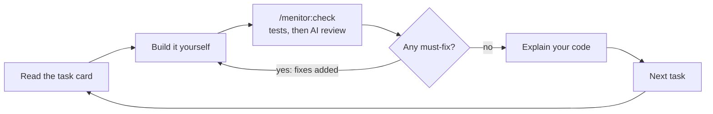
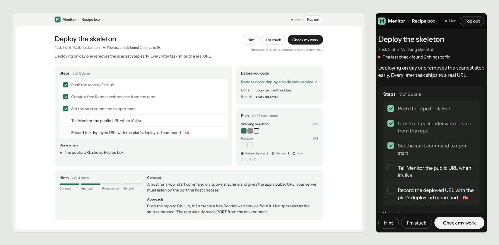

# Menitor

> **You need Node.js 22 or newer on your PATH.** Menitor's state CLI, task window and hooks run on Node. Check with `node --version`.

Menitor is a Claude Code plugin that acts like a senior developer running your project as a sprint, and it makes you do the work.

Tell it your idea. It interviews you, helps you write lean docs, and builds an ordered task plan whose first milestone is a deployed app. Then it shows one task at a time in a small browser window, checks your work before you move on, and asks you to explain your code. The agent can't write the code in your focus areas: hooks block it.

It's free and open source (MIT). It runs fully on your own machine with your existing Claude plan. There are no accounts, servers or telemetry.

**Status:** v0.1, ready for its first testers. See the [changelog](CHANGELOG.md).

## Who it's for

| You are | Menitor gives you |
| --- | --- |
| Teaching yourself to code | Small tasks, more hints, plain words, and git taught from scratch |
| A bootcamp grad | A portfolio app built with a professional workflow on every task |
| An experienced developer learning a new stack | Bigger tasks. The new stack is your focus area, and the basics are delegated |

A 10-minute warm-up picks your level. You never rate yourself.

## Install

In Claude Code 2.1.275 or later:

```text
/plugin install menitor --marketplace Issmuth/menitor
```

On older versions, add the marketplace, then install:

```text
/plugin marketplace add Issmuth/menitor
```

```text
/plugin install menitor@menitor
```

Menitor does nothing in a folder until you run `/menitor:start` there.

## Try it on the sample project

To test Menitor without going through setup, create the sample project. It's a tiny web app with an approved plan, ready for task 1:

```bash
node examples/sample/create.js ../recipe-box
```

Then open `../recipe-box` in Claude Code on your machine, and accept the prompt to trust the folder. The sample's settings load Menitor from this clone. [examples/sample/README.md](examples/sample/README.md) has the scenarios, a test script, and what to do if Menitor doesn't load.

## Quick start

1. Open Claude Code in an empty folder, or in a project you want to keep building.
2. Run `/menitor:start`. Answer one question at a time: your idea, your goal, your time, your experience.
3. Do the short warm-up, pick what you want to learn, and draft the core of your product doc in your own words.
4. Approve the plan.
5. Run `/menitor:go`. The task window opens with your first card.
6. Build the task yourself in your editor, and tick items as you go.
7. Run `/menitor:check`, or press **Check my work** in the window.

Every task follows the same loop:



## Commands

| Command | What it does |
| --- | --- |
| `/menitor:start` | Interview you, set your level and focus areas, write lean docs and the plan |
| `/menitor:go` | Open the window and show the current task, even in a fresh session |
| `/menitor:check` | Run the checks, review your work, ask you to explain it, then pass or add fixes |
| `/menitor:hint` | Show the next hint: concept, then approach, then pseudocode, then a partial snippet |
| `/menitor:stuck` | Debug with you: what you tried, the error, the debugging step, the smallest useful hint |
| `/menitor:skip [--explain]` | Hand the task to Menitor. It pushes back once; confirm with `/menitor:skip --confirm` |
| `/menitor:off` and `/menitor:on` | Turn mentor mode off, so the agent may write code, or back on |

Plain questions still work: ask anything. Commands are only for actions that change your progress. `skip`, `off` and `on` only work when you type them. The agent can't run them for you.

## The task window

`/menitor:go` opens a page in your browser with one task card. Keep it beside your editor, or pop it out.



- **Live:** it updates as soon as anything changes. You never need to reload.
- **Ticks:** tick checklist items as you go. Fixes from a failed check appear as new items.
- **Buttons:** **Check my work**, **Hint** and **I'm stuck** go straight to your Claude Code session. If no session is open, they copy the command for you to paste. The card tells you which of the two will happen.
- **Pop out:** an always-on-top mini window in desktop Chrome, Edge and other Chromium browsers. Other browsers get a small separate window.
- **The plan:** every task in your plan as one cell, marked by who did it: you, Menitor, skipped, the one you're on, or still to do.
- **Hints:** the four-rung ladder shows which hints are open, with their text beside it. Code hints are set as code.
- **Layout:** one column on a phone or in the pop-out, with the buttons always at the bottom of the screen. On a desktop, the steps sit beside the plan and the buttons sit beside the title. It works from 320 px wide, in light and dark mode, and by keyboard.

The window only works on your machine. It listens on 127.0.0.1 and needs the link your session gives you. It loads nothing from outside: even its typeface, Instrument Sans, is bundled under the SIL Open Font License.

## What the agent can and can't do

While mentor mode is on:

- **Your tasks:** it can't write files outside `docs/` and `.menitor/`, even in bypass-permissions mode. Shell commands that would write your files are blocked too. That covers redirects, `sed -i`, copies, deletes, downloads, inline scripts, git commands that change the repo, and installs.
- **Read-only work:** it can still run your build, tests and linter, and read-only git such as `git status`, `git diff` and `git log`.
- **Delegated tasks:** tasks outside your focus areas are delegated. Menitor does those, commits them with a `Menitor-Delegated: true` trailer, and leaves you a two-line note. Your history shows honestly who wrote what.
- **Menitor's own files:** it can't change files in `.menitor/` except through the state CLI.
- **Logged commands:** every command it runs is logged, so a check can flag anything that slipped past.

Turn mentor mode off with `/menitor:off` when you want help writing code, and back on with `/menitor:on`.

## How a check works

`/menitor:check` passes a task only when three things hold:

1. **The automatic checks pass.** Your build, lint and tests run, then the task's own checks, such as fetching your deployed URL. Menitor also checks that you committed your work with a [Conventional Commits](https://www.conventionalcommits.org/) message.
2. **The done-when criteria are met.** The review looks only at what you changed since the task started.
3. **You can explain your code.** You answer one or two open questions in your own words. A weak answer gets a short explanation and one more try. After two tries the task passes, and the concept is noted for you to revisit.

Findings are split into must-fix, which block the pass, and nice-to-have, which don't. You can dispute a must-fix. Menitor then has to show a concrete failing case, or withdraw it.

## Your project's files

Menitor keeps its state in `.menitor/` in your project. The plan is committed, so it travels with your code. Everything personal stays out of your portfolio repo.

| File | Holds | In git |
| --- | --- | --- |
| `plan.json` | milestones, tasks, checklists, done-when criteria, owners, hints | yes |
| `session.json` | the current task, start commits, the last check | no |
| `progress.json` | your checklist ticks | no |
| `learner.md` | your level, focus areas, strengths, recurring mistakes, hint use | no |
| `log.md` | a dated history of checks, hints, skips and disputes | no |
| `guard.json` | mentor mode and skip grants, from commands you typed | no |
| `activity.jsonl` | every command and file write the agent ran | no |
| `window.json`, `inbox.jsonl`, `listener.json` | the running window and its buttons | no |

Your lean docs go in `docs/`, one page each: product requirements, technical requirements, app flow, design brief, data and API contract, and testing approach. Decision records go in `docs/adr/`. You write the first one, for your stack.

## Tips

- **Turn off AI autocomplete in your editor for your focus areas.** Menitor can stop the agent, but not Copilot-style completions. The explain-back questions will show if code isn't yours.
- **Deploy early.** Milestone 1 ends with your app live on a free host: Vercel or Netlify for front-end and full-stack JavaScript, Render for a separate backend, and Neon or Supabase for Postgres.
- **Use hints before skipping.** Each hint is a small step. Skipping a focus-area task hands it over completely.
- **See how you're doing.** `menitor stats` shows the success metrics: time to first deploy, independence, hint trend, check accuracy and explain-back.

## Privacy

Everything stays on your machine. Menitor has no servers, accounts or analytics. It sends nothing anywhere except through Claude Code itself, like any other session.

## Known limits

- **Claude Code on the web doesn't load plugins.** Use Claude Code in the terminal, the desktop app or an IDE.
- **Window buttons need a plugin monitor,** an experimental Claude Code feature. Monitors don't start in `claude -p`. When no session is listening, buttons copy the command instead.
- **The shell guard is best effort.** It reads commands by pattern, so a creative script can slip past. When Claude Code reports the files a command changed, Menitor logs them and the check flags them.
- **Two Claude Code sessions** open on the same project both receive window button presses.
- **v1 is for web apps.** API-only and command-line projects come later.
- **The plan is locked once you approve it.** `/menitor:pivot`, for changing course mid-project, arrives in v1.1.

## Prior art

Menitor borrows proven ideas from these projects and adds the project layer: product docs, a plan ordered for learning, a task window, and checked gates between tasks.

- [Claude Code Learning style](https://code.claude.com/docs/en/output-styles): you write small pieces at `TODO(human)` markers
- [no-vibe](https://github.com/rizukirr/no-vibe): lessons in small layers, hook-guarded writes, graded hints and a learner profile
- [mentor-plugin](https://github.com/teonanacatl/mentor-plugin): edit blocking, a try-first gate and a hint ladder
- [mentor-mode](https://github.com/sefermavi4243-droid/mentor-mode): a hint ladder and an independence score
- [learn-while-build](https://github.com/Pranavraut033/learn-while-build): a concept log and spaced-repetition quizzes

## Contributing

Read the [product requirements](docs/prd.md), the [decision records](docs/adr/README.md) and the [implementation decisions](docs/implementation-decisions.md) first.

```text
core/                     agent-neutral: works with any coding agent
  bin/menitor.js          the state CLI; the agent changes state only through it
  lib/                    plan, learner, log, stats, card, docs, check runner, shell analysis, guard
  schemas/                JSON Schemas for every file in .menitor/
  server/                 the task window: a small HTTP server and a dependency-free page
  instructions/           what each command does, in neutral words
  templates/docs/         lean doc templates
adapters/claude-code/     the thin Claude Code layer: hooks, monitor, command names, generated skills
.claude-plugin/           plugin and marketplace manifests
examples/sample/          a sample project generator, with a test script
test/                     node:test suites
docs/                     PRD, ADRs and implementation decisions
```

There are no runtime dependencies: Node built-ins only, in plain JavaScript with JSDoc types.

```bash
npm install
```

```bash
npm run check
```

`npm run check` type-checks, confirms the generated skills are current, and runs the tests. CI runs it on Linux, macOS and Windows with Node 22 and 24.

The skills in `adapters/claude-code/skills/` are generated. Edit `core/instructions/`, then regenerate:

```bash
npm run build:skills
```

To try your changes in Claude Code, load the plugin from your clone:

```bash
claude --plugin-dir .
```

## License

[MIT](LICENSE) © 2026 Ismael
