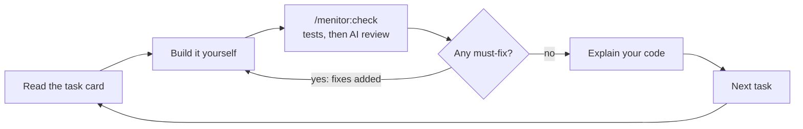

# Menitor

> **Requires Node.js 22 or newer on your PATH.** The task window and the state CLI run on Node.

Menitor is an open-source Claude Code plugin: a senior dev who runs your project like a sprint and makes you do the work. It turns a project idea into lean docs and an ordered task plan. Then it shows one task at a time in a browser window and checks your work before moving on.

It is free (MIT), runs fully locally on your existing Claude plan, and has no accounts or telemetry.

**Status:** in development. v1 is being built in milestones; see [docs/prd.md](docs/prd.md) for the product requirements and [docs/implementation-decisions.md](docs/implementation-decisions.md) for the choices made before the build.

| Milestone | State |
| --- | --- |
| 1. State CLI and schemas | Done |
| 2. Guard hooks | Next |
| 3. Skills (`/menitor:start`, `go`, `check`, `hint`, `stuck`, `skip`) | Planned |
| 4. Check runner | Planned |
| 5. Task window | Planned |
| 6. Window buttons through plugin monitors | Planned |
| 7. README, ADRs and doc templates | Planned |

## How it works

Every task runs the same loop: read the card, build it yourself, check it, then fix or move on.



## Layout

```text
core/                 agent-neutral: works with any coding agent
  bin/menitor.js      the state CLI (the agent changes state only through it)
  lib/                plan, learner, log, stats, card and file helpers
  schemas/            JSON Schemas for every file in .menitor/
test/                 node:test suites
docs/                 PRD and implementation decisions
```

A learner's project keeps its state in `.menitor/`, split by writer so nothing overwrites anything else:

| File | Written by | Holds | In git |
| --- | --- | --- | --- |
| `plan.json` | the CLI | milestones, tasks, checklists, done-when criteria, owners, hints | yes |
| `session.json` | the CLI | current task, start commits | no |
| `progress.json` | the window | checklist ticks | no |
| `guard.json` | hooks, from commands the learner typed | mentor mode, skip grants | no |
| `learner.md` | the CLI | level, focus areas, strengths, mistakes, hint use | no |
| `log.md` | the CLI and hooks | dated history of checks, hints, skips and disputes | no |

## The state CLI

```bash
node core/bin/menitor.js help
```

Common commands: `init`, `plan import`, `plan approve`, `task show`, `task hint`, `task fix`, `task pass`, `task skip`, `log`, `stats`, `status` and `validate`. Every write is schema-validated and atomic.

## Development

```bash
npm install
```

```bash
npm run check
```

`npm run check` runs the type checker and the tests. There is no build step.

## Prior art

Menitor borrows proven ideas and adds the project layer on top: product docs, a plan ordered for learning, a task window and checked gates between tasks.

- [Claude Code Learning style](https://code.claude.com/docs/en/output-styles): you write small pieces at `TODO(human)` markers
- [no-vibe](https://github.com/rizukirr/no-vibe): hook-guarded writes, graded hints, a learner profile
- [mentor-plugin](https://github.com/teonanacatl/mentor-plugin): edit blocking, a try-first gate, a hint ladder
- [mentor-mode](https://github.com/sefermavi4243-droid/mentor-mode): a hint ladder and an independence score
- [learn-while-build](https://github.com/Pranavraut033/learn-while-build): a concept log and spaced-repetition quizzes

## License

[MIT](LICENSE) © 2026 Ismael
