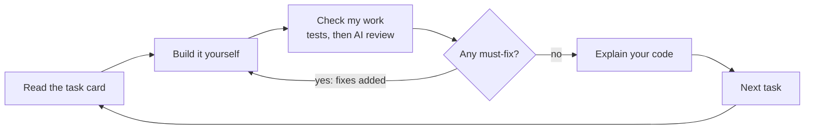

<picture>
  <source media="(prefers-color-scheme: dark)" srcset="logo/Frame%20102.svg">
  
</picture>

# Menitor

Menitor is a Claude Code plugin that acts like a senior developer running your project as a sprint, and it makes you do the work.

Tell it your idea. It interviews you, helps you write lean docs, and builds an ordered task plan whose first milestone is a deployed app. Then it shows one task at a time in a small browser window, checks your work before you move on, and asks you to explain your code. The agent can't write the code in your focus areas: hooks block it.

It's free and open source (MIT). It runs fully on your own machine with your existing Claude plan. There are no accounts, servers or telemetry.

**Status:** v0.1, ready for its first testers. See the [changelog](CHANGELOG.md).

## Contents

- [Who it's for](#who-its-for)
- [What you need](#what-you-need)
- [Install](#install)
- [Start a new project](#start-a-new-project)
- [Work through a task](#work-through-a-task)
- [Commands](#commands)
- [The task window](#the-task-window)
- [The menitor CLI](#the-menitor-cli)
- [What the agent can and can't do](#what-the-agent-can-and-cant-do)
- [How a check works](#how-a-check-works)
- [Your project's files](#your-projects-files)
- [Tips](#tips)
- [Troubleshooting](#troubleshooting)
- [Known limits](#known-limits)
- [Contributing](#contributing)

## Who it's for

| You are | Menitor gives you |
| --- | --- |
| Teaching yourself to code | Small tasks, more hints, plain words, and git taught from scratch |
| A bootcamp grad | A portfolio app built with a professional workflow on every task |
| An experienced developer learning a new stack | Bigger tasks. The new stack is your focus area, and the basics are delegated |

A 10-minute warm-up picks your level. You never rate yourself.

## What you need

- **Node.js 22 or newer** on your PATH. Menitor's state CLI, task window and hooks run on Node. Check with `node --version`.
- **git.** Menitor records your work one task at a time, and checks each commit.
- **Claude Code on your own machine:** the terminal, the desktop app, VS Code or JetBrains. Claude Code on the web doesn't load plugins.
- **A browser.** With Chrome, Edge, Chromium or Brave, the task window opens as an app of its own. Any other browser opens it in a tab.

## Install

In a Claude Code session (v2.1.275 or later), add the marketplace and install in one step:

```text
/plugin install menitor --marketplace Issmuth/menitor
```

On an older version, add the marketplace first, then install:

```text
/plugin marketplace add Issmuth/menitor
```

```text
/plugin install menitor@menitor
```

Claude Code shows what the plugin adds, then asks for a scope. Choose **Install for you**, so Menitor is there in every project. It stays idle in a folder until you run `/menitor:start` there.

To check it loaded, type `/menitor` and look for `/menitor:start` and the other commands.

From your shell, without a session (Claude Code v2.1.292 or later):

```bash
claude plugin install menitor --marketplace Issmuth/menitor
```

**Updates.** Marketplaces outside Anthropic's own don't update by themselves. To get a new version, run `/plugin marketplace update menitor`, then `/reload-plugins`. Or turn on auto-update for the `menitor` marketplace on the **Marketplaces** tab of `/plugin`.

**To try it first**, create the sample project from a clone of this repo. It's a tiny web app with an approved plan, ready for task 1:

```bash
node examples/sample/create.js ../recipe-box
```

Then open `../recipe-box` in Claude Code and accept the prompt to trust the folder. [examples/sample/README.md](examples/sample/README.md) has the scenarios and a test script.

## Start a new project

1. **Make a folder and start git.** Create an empty folder for your project and run `git init` in it. If you forget, Menitor asks you to: git is part of what you learn.
2. **Open Claude Code there and run `/menitor:start`.** Menitor creates `.menitor/` for its state, then asks one question at a time: your idea, your goal, your time each week, your experience and the stack you want. Every answer is saved the moment you give it, so a closed session loses nothing.
3. **Do the warm-up.** The task window opens with a short exercise. Write the code, press **I'm done**, and answer Menitor's question about it in the window. This sets your level.
4. **Make your choices in the window.** Pick your focus areas, the topics you write yourself. Choose hints or type-along. Pick a stack from the one to three Menitor offers, each with its reasons and where it's hosted.
5. **Draft your product's core.** The window shows a box for the problem, the users and the must-have features. Write them in your own words and press **Send for feedback**. Menitor's feedback appears under each part.
6. **Approve the plan.** Menitor writes lean docs in `docs/` and an ordered plan. Its first milestone ends with your app deployed. Read it, ask for changes, then approve it. The plan is locked from then on, but it can grow (see [Commands](#commands)).
7. **Run `/menitor:go`.** The window shows your first task card. From now on, the window opens by itself whenever a session starts on a task.

Already have a project you want to keep building? Run `/menitor:start` in it too. Menitor plans from where the project stands.

## Work through a task

Every task follows the same loop:



1. **Read the card.** It has the goal, why it matters, the one thing to read first, the doc section, the branch, the steps and the done-when criteria.
2. **Build it in your editor.** Start with the branch the card names. Tick each step in the window as you go.
3. **Stuck?** Press **Hint** for the next rung: the idea, then the approach, then pseudocode, then a partial snippet. Press **I'm stuck** to debug together.
4. **Commit, then press Check my work.** Your build, lint and tests run, then a review against the card. A must-fix becomes a new step in the card.
5. **Explain your code.** One or two questions appear in the window. Answer in your own words, there or in your session. Menitor's reply stays on screen until you press **Continue**.
6. **Next task.** The card moves on. Tasks outside your focus areas are Menitor's: press **Start it**, and your next task shows up when it's done.

Along the way:

- **An idea for later?** Add it on the **To-dos** tab. When you want it in the plan, press **Add to plan**.
- **Want to look back?** Select a finished task in the plan.
- **Want help writing code for a while?** Type `/menitor:off`, and `/menitor:on` to go back.
- **Coming back another day?** Open Claude Code in the project. The window opens on your current task, and `/menitor:go` picks up where you left off.

When every task has passed, the window shows what you built and how.

## Commands

| Command | What it does |
| --- | --- |
| `/menitor:start` | Interview you, set your level and focus areas, write lean docs and the plan |
| `/menitor:go` | Open the window and show the current task, even in a fresh session |
| `/menitor:check` | Run the checks, review your work, ask you to explain it, then pass or add fixes |
| `/menitor:hint` | Show the next hint: concept, then approach, then pseudocode, then a partial snippet |
| `/menitor:stuck` | Debug with you: what you tried, the error, the debugging step, the smallest useful hint |
| `/menitor:skip [--explain]` | Hand the task to Menitor. It pushes back once; confirm with `/menitor:skip --confirm` |
| `/menitor:off` and `/menitor:on` | Turn mentor mode off, so the agent may write code and take your tasks without a skip, or back on |
| `/menitor:typealong [off]` | The window shows each step's instructions and full code, and you type it by hand. `off` goes back to hints |
| `/menitor:add <idea>` | Add an idea to the approved plan as a step, a task or a milestone, after you agree where it goes |

Plain questions still work: ask anything. Commands are only for actions that change your progress. `skip`, `off`, `on` and `typealong` only work when you type them; the agent can't run them for you.

### Hints or type-along

`/menitor:start` asks which way you want help, and you can switch any time.

- **Hints** (the default): each hint shows a little more, from the idea to a partial snippet. Best for working things out yourself.
- **Type-along**: each step in the window opens to plain instructions and the full code for that step. You type it in by hand, because the window won't let you copy it: typing it is how it sticks.

Either way the agent never writes your code, and every check still asks you to explain it.

## The task window


The window is a page on your own machine that shows one task at a time. It updates as soon as anything changes, so you never reload it. Keep it beside your editor, or pop it out.

- **Buttons:** **Check my work**, **Hint** and **I'm stuck** go straight to your Claude Code session. When your next move is in the editor or the window, Claude waits for your press. If no session is listening, a button copies the command for you to paste, and the card says which will happen. After a press, the button shows what Menitor is doing until it's done.
- **Whose turn it is:** anything holding up your next task shows at the top: a task that's Menitor's (with **Start it**), a skip waiting for your confirm, or something Menitor needs from you, such as a sign-in or your deployed URL.
- **Before you code:** the one thing to read, the doc section and the branch.
- **Steps:** tick them as you go. Fixes from a failed check appear as new steps.
- **Explain your code:** the check's questions appear with an answer box, and Menitor's reply shows under your answer.
- **The plan:** every task as one cell, marked by who did it: you, Menitor, skipped, the one you're on, or still to do. A dot marks tasks added after you approved the plan. Finished milestones fold into one row and the ones to come into another, so the card stays short however long the plan grows. Select a folded row to open it.
- **Look back:** select a finished task to see who did it, its steps and fixes, Menitor's note, your explanation and the hints you opened. **Previous** and **Next** step through them.
- **To-dos:** a tab of its own beside **Task**. Jot down ideas, features and changes, then edit, tick or delete them; **Undo** brings back a deleted one for a few seconds. **Add to plan** sends one to Menitor, and the to-do then says where it went. A dot on the **Task** tab means something there needs you.
- **Setup:** while `/menitor:start` runs, the window shows your answers so far, the warm-up, the choices and your product draft.
- **The finish:** when every task has passed, the window shows what you built, what Menitor did, your hints and explain-backs, and a link to your live app.
- **Its own window:** with Chrome, Edge, Chromium or Brave, it opens as a maximized app window with no tabs or address bar. **Pop out** gives an always-on-top mini window in desktop Chromium browsers.
- **Everywhere:** it works from 320 px wide, in light and dark mode, and by keyboard. Motion is quiet, and stops if your system asks for reduced motion.

The window only works on your machine. It listens on 127.0.0.1 and needs the link your session gives it. It loads nothing from outside: even its typeface, Instrument Sans, is bundled under the SIL Open Font License.

To open it without asking the agent, run `menitor open` in your project (see [The menitor CLI](#the-menitor-cli)). In a Claude Code session, `! menitor open` runs it straight away.

## The menitor CLI

Menitor keeps its state through one command-line tool, `menitor`. The agent uses it for every change to `.menitor/`. You can use it too, to see where things stand or open the window yourself.

**Get the `menitor` command.** Run `npm link` once in the folder Menitor is installed in: your clone, or the plugin's folder under `~/.claude/plugins/`. Without it, run `node <that folder>/core/bin/menitor.js` instead.

**Commands you might use:**

| Command | What it does |
| --- | --- |
| `menitor open` | Open the task window, starting it if it isn't running |
| `menitor status` | Where the project stands: the plan, the current task, mentor mode, milestones and progress |
| `menitor plan show` | The plan's outline: each milestone and task, and who did it |
| `menitor task show [id]` | A task card; the current task when you leave out the ID |
| `menitor stats` | Your success metrics: time to first deploy, independence, hint trend, check accuracy and explain-back |
| `menitor graph task [id]` | What a task touches: its doc section, the files it names and changed, the files one import away, and their sizes |
| `menitor graph file <path>` | What imports a file and what it imports, the doc sections that name it, and the tasks that changed it |
| `menitor window status` | Whether the window is running, and its link |
| `menitor window stop` | Stop the window |
| `menitor validate` | Check every state file in `.menitor/` |
| `menitor help` | Every command |

**Commands the agent uses.** You rarely need these, but they're all in `menitor help`:

| Area | Commands |
| --- | --- |
| Setup | `init`, `learner show/set/add/remove/note`, `setup set/options/critique/show` |
| Plan | `plan lint/import/add/approve/show/deploy-url`, `hints import`, `steps import` |
| Tasks | `task show/brief/hint/fix/pass/skip`, `go` (the window, the brief and what changed since the task started, in one call) |
| Explain-back | `question ask/show/judge`, `waiting`, `todos show` |
| Checks | `check run`: build, lint, tests, verify steps, commits, ticks and agent activity, then the diff and a review map |
| Context | `graph`, `graph task`, `graph file`, `graph section` |
| History | `log`, `stats`, `status`, `validate` |

**Options** for any command: `--root <dir>` runs it on another project, `--json` prints data instead of text, and `--ids` shows checklist IDs on cards.

**Settings** (environment variables):

| Variable | Effect |
| --- | --- |
| `MENITOR_WINDOW_AUTOSTART=0` | Don't open the window when a session starts on a task |
| `MENITOR_WINDOW_MAXIMIZED=0` | Open the app window at its normal size |
| `MENITOR_WINDOW_APP=0` | Always open the window in a browser tab |
| `MENITOR_NO_BROWSER=1` | Never open a browser; just print the window's link |
| `MENITOR_WINDOW_PORT=<n>` | Serve the window on a fixed port instead of a free one |
| `MENITOR_ROOT=<dir>` | The project the CLI works on, instead of the nearest folder with `.menitor/` |

## What the agent can and can't do

While mentor mode is on:

- **Your tasks:** it can't write files outside `docs/` and `.menitor/`, even in bypass-permissions mode. Shell commands that would write your files are blocked too: redirects, `sed -i`, copies, deletes, downloads, inline scripts, git commands that change the repo, and installs.
- **Read-only work:** it can still run your build, tests and linter, and read-only git such as `git status`, `git diff` and `git log`.
- **Delegated tasks:** tasks outside your focus areas are Menitor's. It does them, commits with a `Menitor-Delegated: true` trailer, and leaves you a two-line note. Your history shows honestly who wrote what.
- **Menitor's own files:** it can't change files in `.menitor/` except through the CLI.
- **Logged commands:** every command it runs is logged, so a check can flag anything that slipped past.

Turn mentor mode off with `/menitor:off` when you want help writing code, and back on with `/menitor:on`. While it's off, Menitor can take your tasks without `/menitor:skip`, and still records each one as skipped, so your plan and stats show who did the work.

## How a check works

**Check my work** (or `/menitor:check`) passes a task only when three things hold:

1. **The automatic checks pass.** Your build, lint and tests run, then the task's own checks, such as fetching your deployed URL. Menitor also checks that you committed with a [Conventional Commits](https://www.conventionalcommits.org/) message.
2. **The done-when criteria are met.** The review looks only at what changed since the task started, guided by a map of the changed lines, the files that use them and the docs that name them.
3. **You can explain your code.** You answer one or two open questions in your own words. A weak answer gets a short explanation and one more try. After two tries the task passes, and the concept is noted for you to revisit.

Findings are split into must-fix, which block the pass, and nice-to-have, which don't. You can dispute a must-fix. Menitor then has to show a concrete failing case, or withdraw it.

## Your project's files

Menitor keeps its state in `.menitor/` in your project. The plan is committed, so it travels with your code. Everything personal stays out of your portfolio repo.

| File | Holds | In git |
| --- | --- | --- |
| `plan.json` | milestones, tasks, checklists, done-when criteria, owners, hints | yes |
| `session.json` | the current task, start commits, the last check, and the to-dos added to the plan | no |
| `progress.json` | your checklist ticks, and the explain-back results you've read | no |
| `learner.md` | your level, focus areas, strengths, recurring mistakes, hint use | no |
| `log.md` | a dated history of checks, hints, skips, disputes and additions | no |
| `guard.json` | mentor mode and skip grants, from commands you typed | no |
| `activity.jsonl` | every command and file write the agent ran | no |
| `solutions.json` | type-along: each step's instructions and code | no |
| `answers.json` | your answers to explain-back questions, typed in the window | no |
| `setup.json` | what you said during setup, saved as you go | no |
| `todos.json` | your to-dos, written in the window | no |
| `graph.json` | the context graph: doc sections, tasks and the files they touch. Rebuilt any time | no |
| `window.json`, `inbox.jsonl`, `listener.json`, `waiter.json`, `claims/` | the running window and its buttons | no |

Your lean docs go in `docs/`, one page each: product requirements, technical requirements, app flow, design brief, data and API contract, and testing approach. Decision records go in `docs/adr/`. You write the first one, for your stack.

## Tips

- **Turn off AI autocomplete in your editor for your focus areas.** Menitor can stop the agent, but not Copilot-style completions. The explain-back questions will show if code isn't yours.
- **Deploy early.** Milestone 1 ends with your app live on a free host: Vercel or Netlify for front-end and full-stack JavaScript, Render for a separate backend, and Neon or Supabase for Postgres.
- **Use hints before skipping.** Each hint is a small step. Skipping a focus-area task hands it over completely.
- **Keep the window open.** When Claude is waiting for your press, the buttons are faster than typing commands.

## Troubleshooting

| What happens | What to do |
| --- | --- |
| `/menitor` shows no commands | Plugins don't load in Claude Code on the web: use the terminal, the desktop app or an IDE. Check `/plugin` lists Menitor as installed and on, then run `/reload-plugins` |
| A hook error mentions `node` | Install Node.js 22 or newer and make sure `node --version` works in a new terminal, then restart Claude Code |
| `/menitor:on` or `/menitor:off` says the hook didn't record it | The plugin's hooks aren't running. Restart Claude Code and check the plugin is on in `/plugin` |
| The window link doesn't open | It only works on the machine running the session. Run `menitor open`, or ask your session for the current task again |
| The window says it's out of date | Menitor was updated while it ran. Ask your session to open the window again, or run `menitor open` |
| The window says Menitor's state has a problem | Run `menitor validate` to see which file, then ask your session to fix it through the CLI |
| A button copied a command instead of sending it | No session was listening. Paste the command into Claude Code |

## Known limits

- **Window buttons reach Claude while it waits.** Claude ends its turn by calling Menitor's `wait_for_learner` tool, which returns the moment you press a button. After two minutes, Claude Code moves the wait to the background, so you can type to Claude as usual. Before then, a message you type arrives when the wait ends; press Esc to send it at once.
- **The shell guard is best effort.** It reads commands by pattern, so a creative script can slip past. When Claude Code reports the files a command changed, Menitor logs them and the check flags them.
- **Two Claude Code sessions** on the same project share window button presses: whichever claims a press first handles it.
- **v1 is for web apps.** API-only and command-line projects come later.
- **An approved plan only grows.** `/menitor:add` adds steps, tasks and milestones, never before the task you're on. Changing or removing planned tasks is `/menitor:pivot`, planned for later.

## Privacy

Everything stays on your machine. Menitor has no servers, accounts or analytics. It sends nothing anywhere except through Claude Code itself, like any other session.

## Prior art

Menitor borrows proven ideas from these projects and adds the project layer: product docs, a plan ordered for learning, a task window, and checked gates between tasks.

- [Claude Code Learning style](https://code.claude.com/docs/en/output-styles): you write small pieces at `TODO(human)` markers
- [no-vibe](https://github.com/rizukirr/no-vibe): lessons in small layers, hook-guarded writes, graded hints and a learner profile
- [mentor-plugin](https://github.com/teonanacatl/mentor-plugin): edit blocking, a try-first gate and a hint ladder
- [mentor-mode](https://github.com/sefermavi4243-droid/mentor-mode): a hint ladder and an independence score
- [learn-while-build](https://github.com/Pranavraut033/learn-while-build): a concept log and spaced-repetition quizzes

## Contributing

Read the [product requirements](docs/prd.md), the [decision records](docs/adr/README.md) and the [implementation decisions](docs/implementation-decisions.md) first.

```text
core/                     agent-neutral: works with any coding agent
  bin/menitor.js          the state CLI; the agent changes state only through it
  lib/                    plan, learner, log, stats, card, docs, check runner, context graph, shell analysis, guard
  schemas/                JSON Schemas for every file in .menitor/
  server/                 the task window: a small HTTP server and a dependency-free page
  instructions/           what each command does, in neutral words
  templates/docs/         lean doc templates
adapters/claude-code/     the thin Claude Code layer: hooks, monitor, MCP wait tool, command names, generated skills
.claude-plugin/           plugin and marketplace manifests
examples/sample/          a sample project generator, with a test script
logo/                     the mark in three colourways
test/                     node:test suites
docs/                     PRD, ADRs, implementation decisions and context cost
```

There are no runtime dependencies: Node built-ins only, in plain JavaScript with JSDoc types.

```bash
npm install
```

```bash
npm run check
```

`npm run check` type-checks, confirms the generated skills are current, and runs the tests. CI runs it on Linux, macOS and Windows with Node 22 and 24.

The skills in `adapters/claude-code/skills/` are generated. Edit `core/instructions/`, then regenerate:

```bash
npm run build:skills
```

To see what each command adds to the agent's context, measured the same way for all, run:

```bash
npm run context-cost
```

Compare it with the baseline in [docs/context-cost.md](docs/context-cost.md) when you change a skill, a hook or CLI output.

To try your changes in Claude Code, load the plugin from your clone:

```bash
claude --plugin-dir .
```

## License

[MIT](LICENSE) © 2026 Ismael
