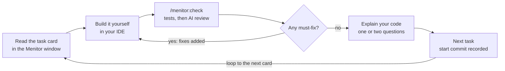
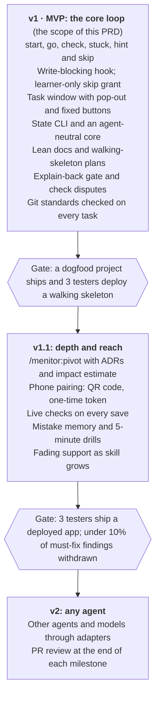

# Menitor — Product Requirements (v1)

Nov 4, 2026 · @Chapa

## Summary

Menitor is an open-source Claude Code plugin: a senior dev who runs your project like a sprint and makes you do the work. It turns a project idea into lean docs and an ordered task plan. Then it shows one task at a time in a browser window and checks the work before moving on.

- **Release:** v1 (MVP), draft 0.1
- **License:** MIT, free for everyone
- **Platform:** Claude Code plugin, with an agent-neutral core so other agents can follow in v2
- **Runs:** fully local, on the learner’s existing Claude plan

## Problem

AI coding tools let beginners ship code they don’t understand. Prompting first and reading the code afterwards builds little skill, and asking the agent to explain only helps a bit.

Existing learning tools fix part of this. Claude Code’s built-in Learning style asks you to write small pieces while Claude builds the rest. Mentor plugins block code writes and give hints, but they teach lessons and single tasks.

None runs a whole product build: from an idea to a deployed, portfolio-ready app, with every step checked before the next one starts.

## Goals and non-goals

v1 succeeds when a beginner ships a deployed app they wrote themselves and can explain.

**Goals**

- The learner writes every line in their focus areas; the agent cannot.
- Take a learner from an idea to a deployed, portfolio-ready app.
- Check each task objectively before moving on.
- Teach professional habits: branches, commits, docs and decision records.
- Run locally on the learner’s existing Claude plan, with no accounts or telemetry.

**Non-goals for v1**

- Other agents and models (v2; the core stays agent-neutral so this needs no rewrite).
- Changing the plan mid-project with /menitor:pivot (v1.1).
- Phone access over the local network (v1.1).
- Teams, cohorts or instructor dashboards.
- Standalone courses or exercises unrelated to the learner’s own project.

## Target users

v1 is tuned for beginners and bootcamp grads; experienced devs are served through levels and focus areas.

| User | What they need | How Menitor adapts |
| --- | --- | --- |
| Self-taught beginner (primary) | Structure, small steps, plain words | Guided level: small tasks, more hints, git basics taught |
| Bootcamp grad (primary) | A portfolio app and job-ready habits | Standard level: full professional workflow on every task |
| Experienced dev learning a new stack | Speed, and depth only where the stack is new | Fast level: bigger tasks; the new stack is the focus area, basics are delegated |

Defaults for task size, explanation depth and test projects follow the two primary rows. A warm-up task during setup picks the starting level; the learner never self-rates.

## Positioning and prior art

Refusing to write code, giving hints and keeping a learner profile are now table stakes. Menitor’s wedge is running a whole project like a sprint: idea, lean docs, ordered tasks, checked gates and a task board on a second screen.

| Tool | Focus |
| --- | --- |
| [Claude Code Learning style](https://code.claude.com/docs/en/output-styles) | Claude builds; you write small pieces at TODO(human) markers |
| [no-vibe](https://github.com/rizukirr/no-vibe) | Lessons in small layers: hook-guarded writes, graded hints, predict-before-run, learner profile |
| [mentor-plugin](https://github.com/teonanacatl/mentor-plugin) | Edit block, try-first gate, hint ladder, weekly review |
| [mentor-mode](https://github.com/sefermavi4243-droid/mentor-mode) | Hint ladder, independence score, shareable weekly card |
| [learn-while-build](https://github.com/Pranavraut033/learn-while-build) | Concept log and spaced-repetition quizzes while you vibe code |

Menitor borrows the proven parts (write blocking, a hint ladder, a learner profile) and credits them in its README. What it adds is the project layer: product docs, a plan ordered for learning, a task window, and checked gates between tasks.

## How it works

Every task runs the same loop: read the card, build it yourself, check it, then fix or move on.

A task moves on only after it passes the check.



Stuck at any point? /menitor:hint gives the next rung and /menitor:stuck works through the error with you. /menitor:skip hands the task to the agent instead.

| Command | What it does | Who can trigger it |
| --- | --- | --- |
| /menitor:start | Interview or import existing docs, calibrate the level, set focus areas, write lean docs and the plan | Learner, typed |
| /menitor:go | Open the window if needed and show the current task; resumes from a fresh session | Learner, typed |
| /menitor:check | Check the current task; a pass moves on, a fail adds fixes to the checklist | Learner, typed or window button |
| /menitor:hint | Reveal the next rung of the hint ladder | Learner, typed or window button |
| /menitor:stuck | Debug with the learner: what they tried, the error, the smallest useful hint | Learner, typed or window button |
| /menitor:skip \[--explain\] | Hand the current task to the agent; --explain adds a short note on what was done and why | Learner, typed only |

Plain questions typed into the session still work; commands are only for actions that change progress. /menitor:pivot arrives in v1.1.

## Setup and planning

/menitor:start ends with a calibrated learner, lean docs in docs/, and a plan whose first milestone is a deployed walking skeleton.

| ID | Requirement |
| --- | --- |
| S-1 | Interview one question at a time: idea, goal, time per week, experience, stack preference. Use multiple-choice prompts for choices and free text for ideas. |
| S-2 | If the learner attaches or already has docs, read them and ask only about the gaps. |
| S-3 | Calibrate with a warm-up task of 10 minutes or less, or by reading an existing repo. Set the level to guided, standard or fast. |
| S-4 | Ask for focus areas: what the learner wants to learn. Everything outside them is delegated by default. |
| S-5 | When no stack is given, recommend one with reasons tied to the goal and level. Push back on stacks too complex for the project. |
| S-6 | The learner drafts the core of the PRD (problem, users, must-have features). The mentor critiques and the learner revises. |
| S-7 | Write lean docs of about one page each into docs/, chosen by project type: PRD, technical requirements, app flow, design brief, data and API contract, testing approach, implementation plan. |
| S-8 | Order the plan for learning. Milestone 1 is a walking skeleton: one thin end-to-end slice, deployed. Each later milestone adds one feature slice. |
| S-9 | Every task has a goal, a why, a docs link, a checklist of 6 items or fewer, objective done-when criteria, 4 locked hint rungs and an owner (learner or delegated). |

## The task window

The window is a localhost page in the learner’s browser that shows one task card at a time, with live progress.

| ID | Requirement |
| --- | --- |
| W-1 | /menitor:go starts the window server if it isn’t running and opens the page. The server binds to 127.0.0.1 only. |
| W-2 | The page updates live when state files change; no reload needed. |
| W-3 | The learner ticks checklist items in the page; ticks are saved to progress.json. |
| W-4 | A Pop out button opens the card as an always-on-top mini window through Document Picture-in-Picture. That works in desktop Chromium browsers and recent Firefox; Safari and mobile get a normal tab. |
| W-5 | The layout works from 320 px wide, so the card fits beside or over the IDE. |
| W-6 | Check, hint and stuck buttons wake the session through a plugin monitor. If the monitor isn’t running, the button copies the command to type instead. |
| W-7 | Buttons send fixed events only. The page can never send free text into the session. |
| W-8 | The page shows milestone progress and how many tasks were learner-written versus delegated. |

Every task renders in this card shape. “Why” is two sentences at most, and a card never contains code.

```text
Task 7/23 · Milestone 2: Sign-up
Goal       Save new users to the database
Why        Sign-ups vanish on restart; a users table makes accounts permanent
Learn      Prisma docs → CRUD: create
[ ] Branch feat/signup-persist
[ ] Add a User model (unique email, passwordHash)
[ ] Run the migration
[ ] Create the user in POST /api/signup
[ ] Commit: feat(auth): persist new users
Done when  Signing up twice with one email shows an error, not a crash
Hints      concept · approach · pseudocode · snippet (all locked)
```

Only one picture-in-picture window can be open per browser, so opening another one (a video, say) closes Menitor’s card.

## Checking work

/menitor:check passes a task only when the deterministic checks pass, the done-when criteria are met, and the learner can explain their code.

| ID | Requirement |
| --- | --- |
| C-1 | Review only the learner’s work: the diff from the commit recorded at task start to the working tree. |
| C-2 | Run deterministic checks first: build, lint, tests and any task-specific commands from the plan. |
| C-3 | Then review against the checklist and done-when criteria. Report each item as done, missing, or ticked but not found. |
| C-4 | Split findings into must-fix and nice-to-have. Only must-fix blocks a pass. |
| C-5 | Explain-back: ask 1 or 2 open questions about the learner’s own code. They answer in their own words, never multiple choice. |
| C-6 | A weak answer gets a short explanation and one follow-up question. After two tries the task passes and the concept is logged to revisit. |
| C-7 | On a fail, append fixes as new checklist items with new IDs. Existing ticks stay. |
| C-8 | On a pass, check commit hygiene, mark the task done, record the next task’s start commit and show the next card. |
| C-9 | The learner can dispute a must-fix. The mentor must show a concrete failing case or withdraw it. |
| C-10 | Load only the doc sections the current task needs, to save tokens. |

## Hints, stuck and skipping

Help comes in the smallest useful step, and full code only arrives through an explicit skip.

| ID | Requirement |
| --- | --- |
| H-1 | The hint ladder has four rungs: concept → approach → pseudocode → partial snippet. A focus-area task never gets the full solution as a hint. |
| H-2 | /menitor:hint reveals the next rung only. Every rung used is logged. |
| H-3 | /menitor:stuck asks what the learner tried, what they expected and what happened. The agent may run the failing command to see the error itself. |
| H-4 | A stuck response teaches the debugging step first (read the error, reproduce, isolate), then gives the lowest useful rung. Fixes appear in the window as checklist items. |
| H-5 | Tasks outside the focus areas are delegated by default. The agent does them and leaves a two-line note. |
| H-6 | Skipping a focus-area task gets one pushback naming what the learner would miss. If they confirm, the agent does it. |
| H-7 | --explain adds a note of one screen or less: what was done, why, and the one concept to know. |
| H-8 | Delegated commits carry a Menitor-Delegated: true trailer, so the history shows honestly who wrote what. |

## Guardrails, git and state

The no-code rule is enforced by hooks, git is part of every task, and all memory lives in files.

| ID | Requirement |
| --- | --- |
| G-1 | A PreToolUse hook denies agent writes outside .menitor/ and docs/ while mentor mode is on. A hook deny holds even in bypass-permissions mode. |
| G-2 | Shell commands that write project files are denied on a best-effort pattern match: redirects, in-place edits, copies into source folders. |
| G-3 | Only the learner grants delegation: a typed /menitor:skip, recorded by a hook, never by the agent. The grant allows writes for that one task. |
| G-4 | The agent changes state only through the menitor CLI. Direct edits to .menitor/\*.json are denied. |
| G-5 | Turning mentor mode off is a learner action; the agent cannot do it. |
| G-6 | Git per task: a branch per milestone or feature, Conventional Commits, and the start commit recorded. |
| G-7 | /menitor:check verifies at least one commit per task with a valid Conventional Commits message. |

State lives in .menitor/, split by writer so the window and the agent never overwrite each other.

| File | Written by | Holds |
| --- | --- | --- |
| plan.json | Agent, through the CLI | Milestones, tasks, checklists, done-when criteria, owners |
| progress.json | Window | Ticks, current task, start commits |
| learner.md | Agent, through the CLI | Level, focus areas, strengths, recurring mistakes, hint use |
| log.md | Agent, through the CLI | Dated history of checks, hints, skips and disputes |

Files are schema-validated and written atomically (temp file, then rename). Checklist items keep stable IDs. /menitor:go rebuilds everything from these files and git, so a fresh session resumes exactly where the last one stopped.

## Non-functional requirements

Menitor stays local, is safe by default, spends few tokens, and keeps working when experimental platform features fail.

| Area | Requirement |
| --- | --- |
| Privacy | Fully local. No accounts, servers or telemetry. |
| Security | The window binds to 127.0.0.1 in v1. The window sends the session fixed events only, never free text. |
| Tokens | Deterministic checks run before AI review. Docs stay around one page each, and a task loads only the sections it needs. |
| Reliability | Typed commands always work. Window buttons fall back to copying the command if monitors fail. State writes are atomic. |
| Portability | An agent-neutral core: state CLI, check runner, window server, doc templates, and instructions in neutral words. A thin Claude Code adapter holds hooks, monitors and command names. |
| Platforms | macOS, Linux and Windows. Node.js on PATH is required for the window and CLI, and the README says so up front. |
| Install | A Claude Code plugin from a marketplace. No npm postinstall scripts. |
| Language | Plain words, sentences under 25 words, and a “Why” of two sentences or fewer. |
| Tone | Hard on the work, kind to the person. Every correction gives the reason and the better path. |
| Accessibility | The window is keyboard-usable, has readable contrast and works at 320 px wide. |

## Release plan

v1 ships the core loop, v1.1 adds depth and reach, and v2 opens Menitor to other agents.

Each release ships only after its gate is met.



Each gate uses the targets in Success metrics, so a release moves on evidence rather than a date.

## Success metrics

v1 works if learners deploy early, do the focus-area work themselves, and need fewer hints over time. These targets are proposals to test with the first testers; with no telemetry, they come from dogfooding and logs testers choose to share.

| Metric | Proposed target | Measured from |
| --- | --- | --- |
| Time to first deploy | Walking skeleton deployed within the first 2 sessions | log.md |
| Independence | 80% or more of focus-area tasks passed without a skip | plan.json owners |
| Hint trend | Fewer hint rungs per task in milestone 3 than in milestone 1 | log.md |
| Check accuracy | Under 10% of must-fix findings withdrawn after a dispute | log.md |
| Explain-back | 90% of questions answered well within two tries | log.md |
| Shipped projects | 3 testers ship a deployed app with Menitor | Tester reports |

## Risks and mitigations

The biggest risk is an unreliable check; most mitigations below exist to keep the check honest.

| Risk | Mitigation |
| --- | --- |
| AI review fails correct work or passes broken work | Deterministic checks first, objective done-when criteria, only must-fix blocks, disputes (C-9) |
| The learner pastes code from another chatbot or IDE autocomplete | Explain-back gate; the README recommends turning autocomplete off for focus areas |
| Skipping becomes the default | Focus areas, one pushback, delegated count shown in the window |
| Plugin monitors change or fail; they are experimental | Commands first; buttons fall back to copying the command |
| The shell-write guard misses a pattern | A PostToolUse hook logs every agent command; /menitor:check flags project files the agent touched |
| Docs drift from the code | One-page docs; /menitor:check flags drift it notices |
| Learners hit their plan’s usage limits | Deterministic checks first, small docs, targeted reads |
| A crowded field of mentor tools | A clear wedge (the whole project as a sprint), credited prior art, a polished demo |

## Decisions and open questions

Seven decisions are settled; each becomes a short ADR in the repo’s docs/adr/ folder.

| ADR | Decision | Why |
| --- | --- | --- |
| 001 | A Claude Code plugin, not a standalone app | It runs on the learner’s plan and gets hooks. A standalone Agent SDK app would need paid API keys. |
| 002 | A localhost web page, not Electron | Any OS, any screen, no install weight |
| 003 | Commands first; window buttons through plugin monitors | Monitors are experimental, and custom channels need a development flag during their research preview |
| 004 | Marketplace plugin, no npm postinstall | pnpm 10 skips dependency install scripts by default, writes into \~/.claude look like an attack, and non-Node projects stay clean |
| 005 | Agent-neutral core plus a Claude Code adapter | v2 can add other agents without a rewrite |
| 006 | /menitor:pivot moves to v1.1 | A first demo project rarely needs it; it is better designed after watching real pivots |
| 007 | Beginners and bootcamp grads are the primary users | Defaults need one target; experienced devs use levels and focus areas |

**Open questions**

- [ ] v1 project types: web apps only, or also API-only and CLI projects?
- [ ] Which of progress.json, learner.md and log.md are committed to git by default?
- [ ] Which free hosting targets does the walking skeleton recommend?
- [ ] Does the fast level start the hint ladder at the approach rung?
- [ ] How does the learner turn mentor mode off and back on: command name and confirmation?

## Sources

- [Claude Code output styles](https://code.claude.com/docs/en/output-styles): the built-in Learning style
- [Claude Code skills](https://code.claude.com/docs/en/skills): disable-model-invocation and the Agent Skills standard
- [Claude Code plugins](https://code.claude.com/docs/en/plugins): namespaced skills and background monitors
- [Claude Code hooks](https://code.claude.com/docs/en/hooks) and [hooks most people miss](https://dev.to/runbyagent/claude-code-hooks-most-people-miss-12p2): a PreToolUse deny holds in bypass mode
- [Claude Code channels](https://code.claude.com/docs/en/channels): research preview and the development flag
- [Waking idle agents with plugin monitors](https://nikiforovall.blog/ai/2026/08/21/claude-code-plugin-monitors.html) and [plugin background monitors](https://www.agentpatterns.ai/tools/claude/plugin-background-monitors/): how monitors work and known issues
- [Agent SDK quickstart](https://platform.claude.com/docs/en/agent-sdk/quickstart): third-party products use API keys
- [pnpm 10.0.0 release notes](https://github.com/pnpm/pnpm/releases/tag/v10.0.0): dependency install scripts off by default
- [Document Picture-in-Picture browser support](https://www.rabbitpair.com/en/products/dualpip/faqs/document-pip-browser-limits)
- Prior art: [no-vibe](https://github.com/rizukirr/no-vibe), [mentor-plugin](https://github.com/teonanacatl/mentor-plugin), [mentor-mode](https://github.com/sefermavi4243-droid/mentor-mode), [learn-while-build](https://github.com/Pranavraut033/learn-while-build)
